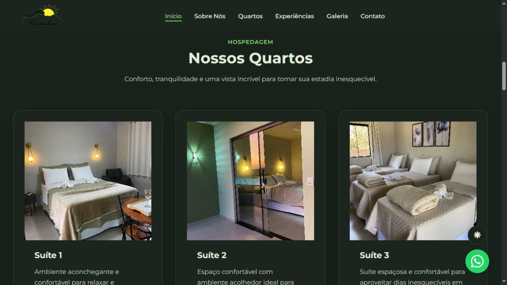
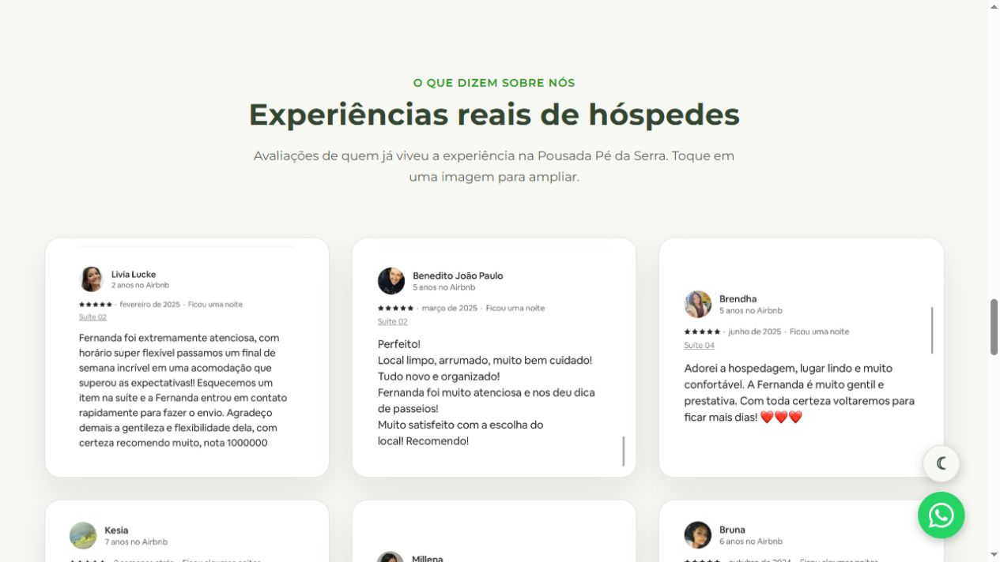
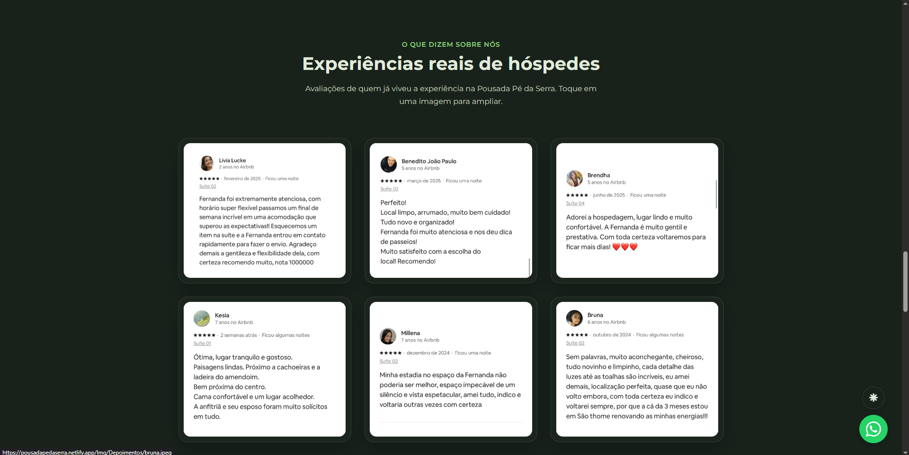
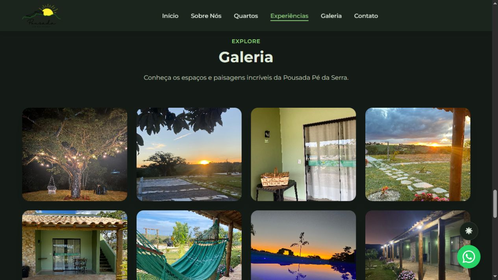
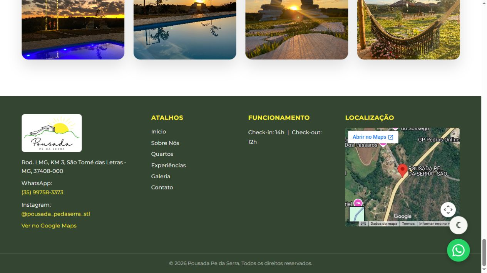

<p align="center">
  
</p>

<h1 align="center">Pousada Pé da Serra</h1>

<p align="center">
  Um site para apresentar a pousada, seus espaços e experiências em São Thomé das Letras, Minas Gerais.
</p>

<p align="center">
  
  
</p>

---

## Sobre o projeto

O site da Pousada Pé da Serra foi criado para aproximar os hóspedes da pousada antes mesmo da chegada. Com uma identidade visual acolhedora, ele reúne informações sobre a hospedagem, apresenta os ambientes e facilita o contato para tirar dúvidas ou solicitar uma reserva.

A pousada fica em São Thomé das Letras, destino conhecido pelas paisagens da serra e pelo clima tranquilo. O conteúdo do site destaca essa experiência e a proposta familiar da pousada, com foco em conforto, descanso e atendimento próximo.

## O que você encontra no site

- **Apresentação da pousada:** história, proposta e informações para conhecer o lugar.
- **Seis suítes:** cards com fotos, capacidade e acesso direto ao contato para consultar uma reserva.
- **Benefícios:** informações sobre café da manhã, piscina e Wi-Fi.
- **Galeria e avaliações:** imagens para conhecer os espaços e registros de experiências de hóspedes; as imagens da galeria podem ser ampliadas.
- **Contato e localização:** atalhos para WhatsApp e Instagram, além de mapa incorporado.
- **Navegação entre páginas:** página inicial e página “Sobre”, com acesso às principais seções.

## Capturas de tela

### Página inicial

<p align="center">
  
</p>

### Suítes

<p align="center">
  
</p>

### Feedbacks dos hóspedes

<p align="center">
  
</p>

<p align="center">
  
</p>

### Galeria

<p align="center">
  
</p>

### Contato e localização

<p align="center">
  
</p>

## Tecnologias

- **HTML** para estruturar as páginas e o conteúdo.
- **CSS** para a identidade visual e a apresentação dos elementos.
- **JavaScript** para interações como navegação, galeria ampliada e atalhos de contato.

As páginas publicadas (`index.html` e `sobre.html`) são estáticas e não exigem uma etapa de build. A pasta `classes/` também contém componentes PHP para representar dados da pousada, quartos, contato e links do WhatsApp.

## Estrutura do projeto

```text
Site_Pousada_Pe_da_Serra/
├── Img/
│   ├── Galeria/       # Imagens da pousada e avaliações
│   ├── Suíte/         # Fotos das suítes
│   ├── README/        # Capturas de tela usadas neste documento
│   └── Logo.png
├── classes/           # Componentes PHP de pousada, quarto, contato e WhatsApp
├── index.html         # Página inicial
├── sobre.html         # Página sobre a pousada
├── script.js          # Interações do site
├── style.css          # Estilos e identidade visual
└── README.md
```

## Equipe

- [Redellen Junior](https://github.com/RedellenJ)
- [Emmanuel Andrade](https://github.com/emmanuel-andrade4)
- [Eduardo Mendes](https://github.com/eduardo-es)
- [Vinícius Lemes Cazelato](https://github.com/ViniciusLC-30)
- [Matheus Souza Reys](https://github.com/MatheusReys)
